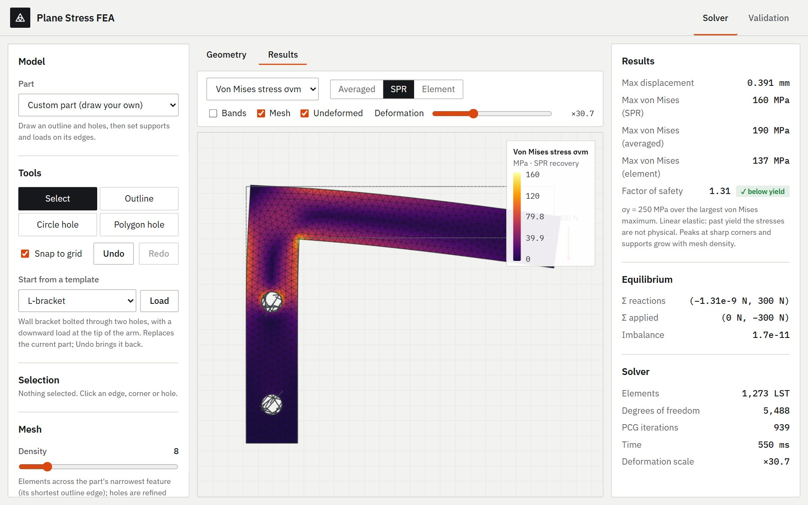
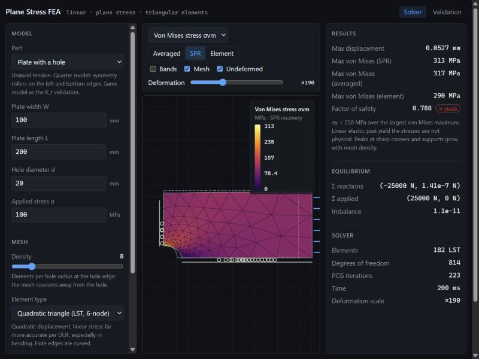
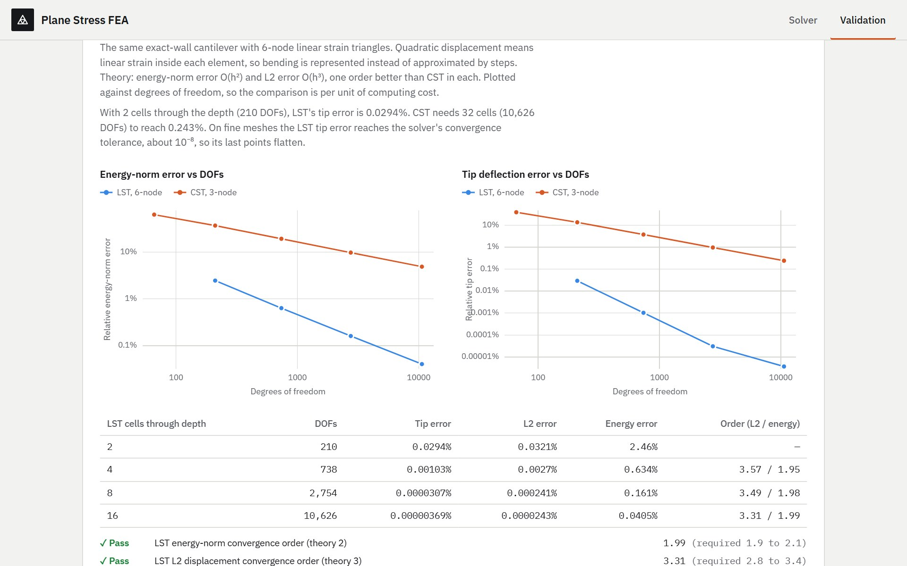

# Plane Stress FEA

A 2D finite element solver that runs entirely in the browser. Pick a preset or draw
your own part, set supports and loads on its edges, choose a material, and see the
deformed shape and a von Mises (or σx, σy, τxy, |u|) stress map.

The FEA core is written from scratch, with no FEA or linear-algebra libraries:
- element formulations;
- sparse assembly and the conjugate-gradient solver;
- Delaunay and DistMesh meshing;
- stress recovery.

Results are validated against analytical solutions **live on the site**, by the same
code and the same tolerances the test suite checks in CI.



## What it does

- **Parts:** cantilever beam, tension strip, plate with a hole, or a custom part.
  Custom parts are drawn in the geometry editor: outline, circular and polygonal
  holes, snapping, undo, and autosave.
- **Supports and loads on any edge,** hole edges included:
  - supports: fixed, or a roller in x or y;
  - loads: total force, pressure, or traction.

  They stay attached when the part is edited or re-meshed.
- **Elements:**
  - 3-node constant strain triangles (CST);
  - 6-node isoparametric linear strain triangles (LST), with curved hole edges.
- **Meshing:**
  - structured meshes for the presets;
  - DistMesh on a signed-distance description of the part, built on a
    from-scratch Bowyer–Watson Delaunay triangulation, with elements graded finer
    toward holes.
- **Results:**
  - deformed shape, with the exaggeration factor always shown;
  - stresses as raw element values, nodal averages, or superconvergent patch
    recovery (SPR);
  - hover probe, contour bands, and pan/zoom, including from the keyboard;
  - factor of safety, and an equilibrium check on every solve.
- **Solving runs in a Web Worker,** with results transferred rather than copied
  and the latest request always winning, so the page stays responsive.



## Validation

The **Validation** page (`#/validation`) reruns every study in your browser:

| Study | Reference | Result |
|---|---|---|
| Cantilever, exact elasticity solution | Timoshenko & Goodier | CST: orders 1.99 (tip, L2) and 1.00 (energy), as theory predicts. LST: 3.31 (L2) and 1.99 (energy) |
| Cantilever, fully clamped wall | Timoshenko beam, κ = 5/6 | −0.30% (Richardson-extrapolated CST); LST converges to the same value |
| Plate with a hole, W/d = 10 (**gross** basis) | Kirsch (3.000); Heywood, converted to gross (3.032) | K_t,g = 3.031: 1.0% above Kirsch, which is the finite-width effect, and −0.06% from Heywood |
| Plates, d/W = 0.1–0.5 (**net** basis) | Heywood, K_t,n = 2 + (1 − d/W)³ | −0.06% to +1.69% |
| CST vs LST at equal cost | — | LST with 210 DOFs beats CST with 10 626 DOFs on tip deflection (0.029% vs 0.24%) |

Kirsch and Heywood normalise the peak stress by different reference stresses: the
far-field gross stress and the net-section stress. Every stress concentration
result in the code carries an explicit `basis: 'gross' | 'net'`, and the labels are
generated from it.



## The math

Each part of the solver has a note in [`docs/math/`](docs/math/README.md). Each one
covers the derivation, the code that implements it, the tests that check it, and
likely interview questions:

1. Plane stress and the D matrix
2. The constant strain triangle
3. Assembly, loads and boundary conditions, including why equilibrium holds exactly
4. Conjugate gradient and Cholesky
5. Stress recovery and von Mises
6. Cantilever validation: exact solution, error norms, convergence rates
7. Reading the results: deformation scale, colour, singular peaks
8. Delaunay, DistMesh, SPR, and the plate with a hole
9. The geometry editor's computational geometry
10. The 6-node LST: isoparametric mapping, quadrature, curved edges

[`docs/PLAN.md`](docs/PLAN.md) has the roadmap and the stress definitions.

## How it is built

```
src/core/        solver: D matrix, CST and LST elements, sparse assembly,
                 boundary conditions, PCG and Cholesky, stress recovery
src/mesh/        structured mesher, Delaunay, DistMesh, quadratic elevation, quality
src/model/       supports and loads on geometry edges → solver model
src/editor/      pure editor logic: geometry operations, validation, hit tests, undo
src/validation/  analytical solutions, validation cases, shared pass/fail criteria
src/worker/      solver and validation Web Workers
src/render/      WebGL2 field renderer, Canvas2D overlays, colormaps, view transform
src/ui/          React panels, viewport, geometry editor, validation page, charts
tests/           Vitest unit and validation tests
```

The stack is TypeScript, React, Vite and Vitest. The solver core has no
dependencies, and the result is a static site.

## Development

Requires Node 24+.

```bash
npm install
npm run dev        # dev server
npm test           # unit and validation tests
npm run lint
npm run build      # type-check and build the static site into dist/
```

Pushing to `main` runs lint, tests and the build in GitHub Actions. The site is
hosted on Vercel, which builds and deploys `main` on its own.

## Limitations

- **Physics:** linear elastic, small displacement, isotropic, plane stress only.
  No plane strain, body forces, thermal loads, contact, or nonlinear materials.
- **Singular peaks:** sharp re-entrant corners and fully clamped corners are stress
  singularities, so their peaks grow as the mesh is refined. The editor has no
  fillets.
- **Supports** apply to whole geometry edges; there are no point supports.
- **One load case** at a time.
- **Solver speed:** PCG uses a Jacobi preconditioner, so iteration counts grow as
  the mesh is refined. DistMesh takes 1–3 s on fine graded meshes.
- **Precision:** the LST tip-deflection error stops at about 10⁻⁸ because of the
  solver's stopping tolerance.
- **Browser:** WebGL2 is required.
